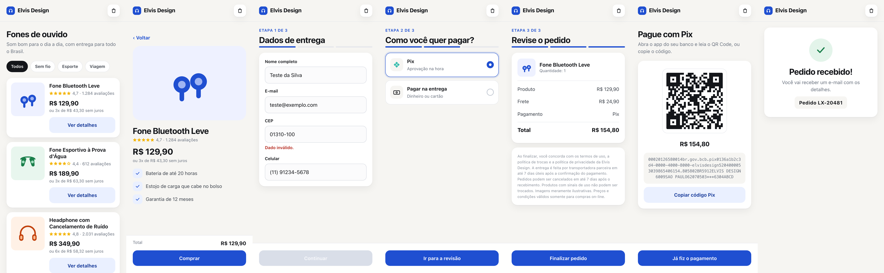

# ux-web_loja-exemplo · teste de usabilidade com pensar em voz alta

Uma persona compra um fone de ouvido na **Elvis Design**, uma loja fictícia que vem dentro da tarefa
(`input/site/index.html`, sem login e sem internet). A sessão é gravada em vídeo e a persona pensa em voz alta.

## Fluxo

Vitrine → produto → dados de entrega (etapa 1 de 3) → forma de pagamento: Pix ou na entrega (etapa 2) →
revisão (etapa 3) → QR Code do Pix (se escolheu Pix) → pedido recebido.

## Gabarito: problemas plantados

Use para conferir se as personas acharam os problemas (e quais acharam sozinhas). **Não mostre à persona.**

| # | Onde | Problema | Heurística de Nielsen |
|---|---|---|---|
| 1 | Entrega, CEP | CEP com hífen é recusado com "Dado inválido.", sem dizer o formato | 9. Ajudar a reconhecer e corrigir erros |
| 2 | Entrega, botão | "Continuar" funciona, mas parece desativado | 1. Visibilidade do estado do sistema |
| 3 | Revisão | O frete de R$ 24,90 só aparece no fim | 1. Visibilidade · 5. Prevenção de erros |
| 4 | Pix | "Copiar código Pix" não avisa que copiou | 1. Visibilidade do estado do sistema |
| 5 | Pedido recebido | Não informa o prazo de entrega | 6. Reconhecer em vez de lembrar |

## O que a persona entrega

- `/app/output/resultado_teste.json`: resultado, passos, dificuldades, **SEQ adaptada por tarefa** (dificuldade, clareza e suficiência, de 1 a 7), problemas encontrados com gravidade, sugestões e fechamento.
- `/app/output/user_feedback.json`: nota da experiência, confiança e se compraria de novo.
- `/app/output/video/seg_*.webm`, `fala_em_voz_alta.jsonl` e `eventos.jsonl`: matéria-prima do vídeo (`ux/montar_video.py`).

## Testar sem IA

`solution/solve.sh` percorre a compra pela tela como uma pessoa faria. Serve para conferir o ambiente antes de gastar com o modelo.
